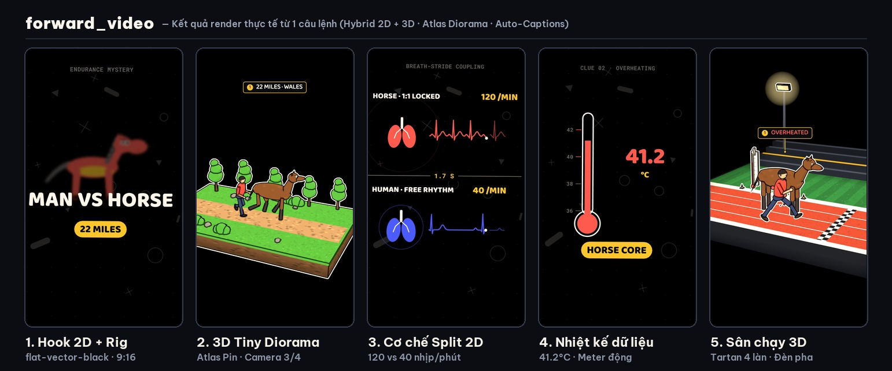
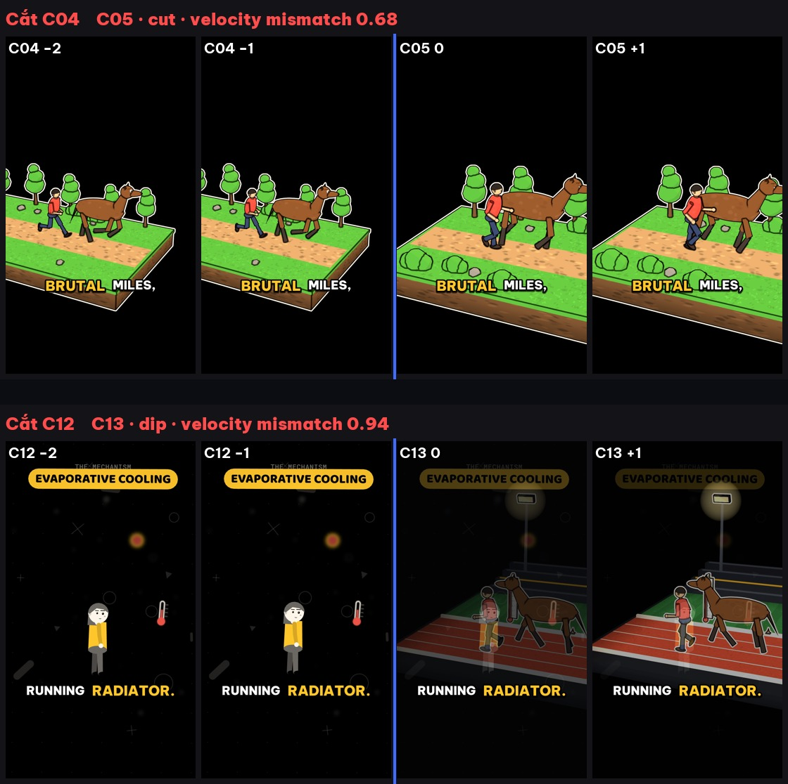
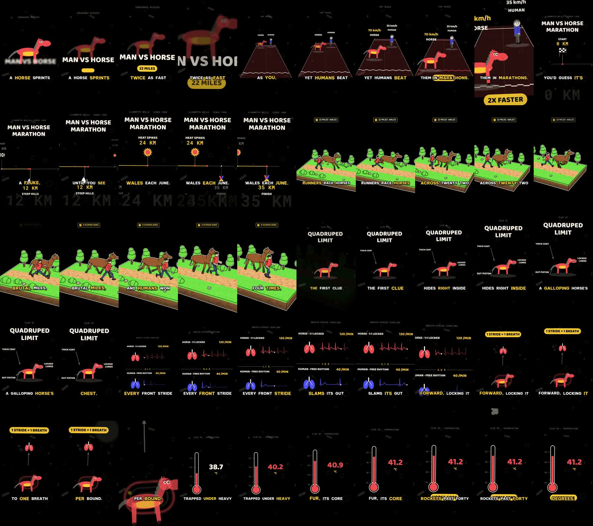
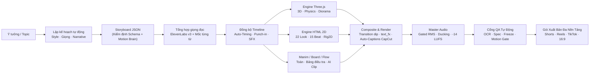

<div align="center">

# `forward_video`

**Nền tảng sản xuất video ngắn tự động bằng một lệnh — kết hợp 2D Motion Graphics, 3D Procedural (Three.js + Rapier Physics), Manim, Evidence Board, Auto-Captions kiểu CapCut và Cổng kiểm định QA tự động.**

[](https://www.python.org/)
[](engines/)
[](styles/)
[](config/metaphors.json)
[](tests/)
[](ruff.toml)

[Tổng quan](#tổng-quan) · [Kết quả thực tế](#kết-quả-thực-tế) · [Kiến trúc hệ thống](#kiến-trúc-hệ-thống) · [Tính năng nổi bật](#tính-năng-nổi-bật) · [Cài đặt nhanh](#cài-đặt-nhanh) · [Hướng dẫn sử dụng](#hướng-dẫn-sử-dụng) · [Cấu trúc dự án](#cấu-trúc-dự-án)

</div>

---

## Kết quả thực tế

> Mọi hình ảnh bên dưới được **render trực tiếp từ mã nguồn của `forward_video`** trên một video thật (*"Why a human can outrun a horse in a marathon"* — định dạng dọc `1080×1920`, `30 fps`, âm lượng chuẩn `-14.1 LUFS`, **56/56 OCR Xanh**, **0 lỗi đỏ QA**).

### Khung hình tiêu biểu (Hybrid 2D ↔ 3D · Atlas Diorama · Sân chạy 3D · Auto-Captions)



### Chuyển cảnh 2D ↔ 3D mượt (`dip`), góc máy 3/4 bám chủ thể & Auto-Captions kiểu CapCut



### Bảng kiểm toàn bộ video (Contact Sheet 50 khung hình · QA tự động)



---

## Tổng quan

**`forward_video`** là dây chuyền sản xuất video dọc 9:16 (**YouTube Shorts · TikTok · Instagram Reels**) và bản ngang 16:9 khép kín từ **một ý tưởng duy nhất** cho tới gói xuất bản hoàn chỉnh (`final.mp4`, thumbnail 3 biến thể, `captions.srt`, `publish.md`, báo cáo QA HTML, và gói phân phối đa nền tảng).

Thay vì ghép nối thủ công nhiều phần mềm dựng phim, toàn bộ quyết định đạo diễn (kịch bản, chọn style, chọn giọng đọc, cơ chế chuyển động, camera 3D, hiệu ứng âm thanh, phụ đề từng từ, kiểm định chất lượng) được **chuẩn hóa thành dữ liệu (`storyboard.json`)** và thực thi **tất định (deterministic)** qua 5 engine render song song.

### Chỉ số cốt lõi của hệ thống

| Hạng mục | Quy mô hiện tại | Ghi chú kỹ thuật |
|---|---|---|
| **Thư viện Style** | **80 style** (`styles/*.json`) | Gồm 2D, 3D, 37 biến thể Dark-Stage từ 3D Style Atlas, `retro90-lowpoly-black`, `vox-editorial-black`, `cartoon-story-black` |
| **Engine dựng hình** | **5 engine** dùng chung adapter | `three.js` · `html` (Canvas 2D) · `manim` · `board` · `Google Flow` (trộn được trong cùng 1 video) |
| **Kho cơ chế chuyển động** | **175 cơ chế** (`config/metaphors.json`) | Chống lặp khung xương giữa các video (`vidlib/motionplan.py`) |
| **Bối cảnh & Sinh vật 3D** | **8 bối cảnh** · **22 loài 3D** · **400+ glTF** | `stadium`, `track`, `diorama`, `meadow`, `street`, `tabletop`, `lab`, `black` + vật lý Rapier |
| **Look 2D & Nhân vật 2D** | **22 look** · **15 beat** · **189+ icon** · **16 loài rig2d** | Hỗ trợ chiều sâu `z`/DOF, camera dolly, motion verbs và tài sản SVG/Lottie/Rive |
| **Auto-Captions CapCut** | **4 preset + tắt** | `capcut_pop` · `capcut_pill` · `capcut_box` · `vox_highlight` (khớp từng từ ElevenLabs) |
| **Tốc độ render GPU** | **~0.06 – 0.12 giây/frame** | Playwright Headless Edge/Chromium · 2 worker GPU · hỗ trợ **RESUME** theo hash |
| **Kiểm định chất lượng** | **314 unit tests · 0 lỗi Ruff** | Cổng QA Đỏ/Vàng/Xanh: BT.709, `-14 LUFS`, True Peak `≤ -1 dBTP`, freeze/black, OCR, motion gate |

---

## Kiến trúc hệ thống



---

## Tính năng nổi bật

### 1. Đa Engine Hybrid 2D ↔ 3D liền mạch
- **Engine `three.js` (`engines/three/`)**: 11 chất liệu 3D (`toon`, `clay`, `plastic`, `glass`, `chrome`, `lowpoly`, `paper`, `holo`, `xray`, `retro90`, `psx`), mô phỏng vật lý cứng **Rapier**, 22 loài sinh vật/người 3D vẽ mặt trên texture, 8 bối cảnh thu nhỏ kiểu **3D Style Atlas** (`stadium`, `track`, `diorama`, `meadow`, `street`, `tabletop`, `lab`, `black`), camera 3/4 tự động bám chủ thể (`frame.follow`) và lớp `overlay2d` gắn pin đánh số (`pin: 1, 2, 3`).
- **Engine `html` (`engines/html/`)**: 22 ngôn ngữ đồ họa trên nền tối (bao gồm **Vox Editorial Dark-Mode** với bút dạ quang vàng quẹt theo từ khóa và **Cartoon Story Dark-Mode** viền đen sắc nét), 15 beat động theo dữ liệu (`timeline`, `split`, `meter`, `units`, `compare:race`, `process:domino`, `fact:flip`, `scene` tự do có chiều sâu `z` và motion verbs).
- **Chuyển cảnh thông minh (`vidlib/fx.py`, `vidlib/render.py`)**: Tự áp chuyển cảnh `dip` mượt mà khi chuyển giữa 2D `html` ↔ 3D `three.js`, nối các shot 2D liền kề thành **một cú máy liên tục (HTML spine)**.

### 2. Auto-Captions kiểu CapCut bám chính xác từng từ (`vidlib/autocaptions.py`)
Tận dụng trực tiếp **word-level timestamps** từ ElevenLabs để đốt phụ đề mượt từng frame với khoảng cách chữ tự giãn theo hiệu ứng nảy (`spring`), không bao giờ dính chữ:
- **`capcut_pop`** *(mặc định)*: Chữ đậm viền đen + bóng mềm, từ đang đọc phóng nảy `1.14×` và sáng vàng nổi bật.
- **`capcut_pill`**: Từ đang đọc nằm trong viên thuốc bo tròn màu accent.
- **`capcut_box`**: Hộp đen bo tròn gọn + nhấn vàng kiểu banner kể chuyện mạng xã hội.
- **`vox_highlight`**: Dải bút dạ quang vàng Vox (`#F5D547`) quẹt ngang từ trái sang phải theo đúng tốc độ đọc từ.
- **`off`**: Tắt burn-in, chỉ giữ file phụ đề rời `out/captions.srt`.

### 3. Bộ não chống lặp Motion (`vidlib/motionplan.py`)
- Tự động ghi nhận **chữ ký chuyển động (motion signature)** của mỗi video đã xuất và đối chiếu với 3–5 video gần nhất.
- Cân bằng tự động: giới hạn thẻ chữ/số chung chung `≤ 45%`, yêu cầu tối thiểu `≥ 3` shot cơ chế thật, xoay vòng bố cục (`layout`), kiểu bay camera (`spine`), dạng kịch bản (`narratives`), style và giọng đọc.

### 4. Giao diện Web Studio 8 công đoạn (`ui/`)
Không cần nhớ lệnh dòng lệnh — mở trình duyệt cục bộ tại `http://127.0.0.1:8765` (Python stdlib + ES modules thuần, không cần bước build Node):
- **8 trang công đoạn**: `Projects` · `Script` (dán & kiểm JSON trực tiếp, hoàn tác lịch sử) · `Board` · `Generate` (kéo thả clip Flow) · `Edit` · `Review` (chấm timecode + ghi chú) · `Deliver` · `Library` (duyệt 80 style, giọng, tài sản 3D/SVG).

### 5. Cổng QA Đỏ / Vàng / Xanh & Đóng gói đa nền tảng
Mỗi video xuất ra tự động được kiểm định toàn diện và xuất báo cáo `qa/report.html`:
- **Kỹ thuật**: `1080×1920`, `30 fps`, H.264 High, dải màu `BT.709`, `yuv420p`, `faststart`, audio `48 kHz`.
- **Âm thanh**: Gated RMS ducking, chuẩn hóa tuyến tính `-14 ± 1 LUFS`, True Peak `≤ -1.0 dBTP`.
- **Thị giác**: Phát hiện đứng hình (`freeze ≥ 0.4s`), khung đen (`black frame`), cổng chuyển động (`motion_gate` chặn video dạng slide tĩnh), **OCR kiểm chính tả toàn bộ chữ trong cảnh**, và kiểm tra bản quyền tài sản (`rights.json`).

---

## Cài đặt nhanh

### Yêu cầu môi trường
- **Python ≥ 3.10** (khuyến nghị Python 3.11 – 3.13)
- **FFmpeg** (có trong `PATH`)
- **Microsoft Edge** hoặc **Chromium** (cho Playwright render WebGL/Canvas 2D)
- **Tesseract OCR** (tùy chọn — dùng cho bước QA kiểm chính tả chữ trong video)
- **Khóa API ElevenLabs** (đặt trong file `.env` — không bắt buộc nếu chạy chế độ `--dry-run`)

### Các bước cài đặt

```powershell
# 1. Clone kho mã nguồn
git clone https://github.com/<your-username>/forward_video.git
cd forward_video

# 2. Tạo môi trường ảo và cài thư viện Python
python -m venv .venv
.venv\Scripts\activate
pip install -r requirements.txt

# 3. Cài đặt FFmpeg (Windows)
winget install Gyan.FFmpeg

# 4. Tạo file .env chứa khóa ElevenLabs (tùy chọn)
echo ELEVENLABS_API_KEY=your_api_key_here > .env

# 5. Kiểm tra toàn bộ môi trường
python studio.py doctor
```

---

## Hướng dẫn sử dụng

### Cách 1: Dùng Giao diện Web (Khuyên dùng)

```powershell
python studio.py ui
# Hoặc nháy đúp file ui.bat trên Windows → tự mở http://127.0.0.1:8765
```

### Cách 2: Dùng Dòng lệnh (CLI)

```powershell
# Tạo và chạy trọn gói 1 video mới từ ý tưởng
python studio.py video "Why a human can outrun a horse in a marathon"

# Chạy thử không tốn credit (dùng giọng & nhạc tổng hợp cục bộ)
python studio.py video "What happens if you stop sleeping for 7 days" --dry-run --no-flow

# Chọn trực tiếp Style mới (Vox Editorial / Cartoon Story / Retro 90s) và kiểu phụ đề CapCut
python studio.py video <slug> --style vox-editorial-black --captions vox_highlight --from text --look-ok --yes
python studio.py video <slug> --style cartoon-story-black --captions capcut_box --from text --look-ok --yes
python studio.py video <slug> --style retro90-lowpoly-black --captions capcut_pop --from text --look-ok --yes
```

### Bảng lệnh thường dùng

| Lệnh | Công dụng |
|---|---|
| `python studio.py ui` | Khởi chạy Giao diện Web Studio (`http://127.0.0.1:8765`) |
| `python studio.py video "<ý tưởng>"` | Chạy pipeline sản xuất video từ đầu đến cuối |
| `python studio.py video <slug> --from render --look-ok --yes` | Render lại nhanh video cuối (tái sử dụng toàn bộ shot đã render nhờ RESUME) |
| `python studio.py video <slug> --captions capcut_pill` | Đổi kiểu phụ đề burn-in (`capcut_pop` · `capcut_pill` · `capcut_box` · `vox_highlight` · `off`) |
| `python studio.py styles` · `voices` · `narratives` | Liệt kê kho 80 style, kho giọng đọc và 10 khung kể chuyện |
| `python studio.py styles --plan "<ý tưởng>"` | Xem trước kế hoạch style + giọng + dạng kịch bản hệ thống sẽ chọn |
| `python studio.py sb check <slug>` | Kiểm định `storyboard.json` (schema, từ vựng engine, motion brain, linter) |
| `python studio.py sb preview <slug> C04 --u 0.5` | Dựng nhanh 1 frame xem trước của bất kỳ shot code nào |
| `python studio.py rerender <slug> C04` | Render lại riêng một shot, giữ nguyên toàn bộ các shot còn lại |
| `python studio.py deliver <slug> --platforms all` | Đóng gói và đo lại spec cho YouTube Shorts, Reels, TikTok và YouTube 16:9 |
| `python studio.py doctor` | Chẩn đoán môi trường (FFmpeg, Edge/GPU, Tesseract, font, API key) |

---

## Cấu trúc dự án

```text
forward_video/
├── studio.py                 # Điểm vào CLI chính của toàn bộ pipeline
├── config/                   # Cấu hình kênh (channel.json), 175 cơ chế (metaphors.json), 10 narratives, delivery, atlas
├── styles/                   # 80 preset style (2D, 3D, Vox Editorial, Cartoon Story, Retro 90s, 3D Style Atlas)
├── engines/                  # 5 đường dựng thống nhất qua adapter.py
│   ├── three/                #   Engine 3D Three.js: 11 look, 22 loài 3D, 8 bối cảnh diorama/stadium, vật lý Rapier, hybrid 2D↔3D
│   ├── html/                 #   Engine 2D Canvas: 22 look, 15 beat, 189+ icon, nhân vật rig2d, post2d WebGL2
│   ├── manim/                #   Engine đồ thị, vector & phương trình toán/vật lý
│   └── board/                #   Engine bảng điều tra (Evidence Board) & phim câm
├── vidlib/                   # Lõi pipeline: storyboard, motionplan, autocaptions, render, mix, qa, qagate, deliver
├── lib/motion/               # Thư viện easing, spring & từ vựng motion verbs dùng chung Python ↔ JS
├── ui/                       # Giao diện Web Studio 8 công đoạn (Python stdlib backend + ES Modules frontend)
├── assets/                   # Font chữ OFL/Apache, SFX tổng hợp, thương hiệu kênh
├── prompts/                  # Schema storyboard & prompt hướng dẫn AI viết kịch bản
├── tests/                    # 314 unit tests kiểm tra toàn bộ engine, pipeline, QA, UI và motion brain
└── docs/                     # Tài liệu kỹ thuật, thiết kế hệ thống và ảnh kết quả (docs/showcase/)
```

---

## Kiểm thử & Chất lượng mã nguồn

Toàn bộ kho mã được bảo vệ bởi **314 unit tests** và cấu hình **Ruff** chặt chẽ:

```powershell
# Kiểm tra quy chuẩn mã nguồn (0 lỗi)
python -m ruff check .

# Chạy toàn bộ 314 bài kiểm thử
python -m unittest discover -s tests

# Chạy smoke test kiểm tra tất cả engine ở chế độ dry-run
python scripts/smoke.py
```

---

## Ghi nhận nguồn & Giấy phép

- Toàn bộ mã nguồn pipeline, engine dựng hình và bộ lọc trong kho này được phát triển cho **`forward_video`**.
- Font chữ đi kèm trong `assets/fonts/` sử dụng giấy phép mã nguồn mở **OFL-1.1** và **Apache-2.0** (chi tiết trong từng file `LICENSE-*.txt` / `OFL-*.txt` và `docs/CREDITS.md`).
- Các tài sản 3D/SVG tham khảo và trạng thái bản quyền từng video được hệ thống tự động lập sổ theo dõi tại `out/rights.json`.
